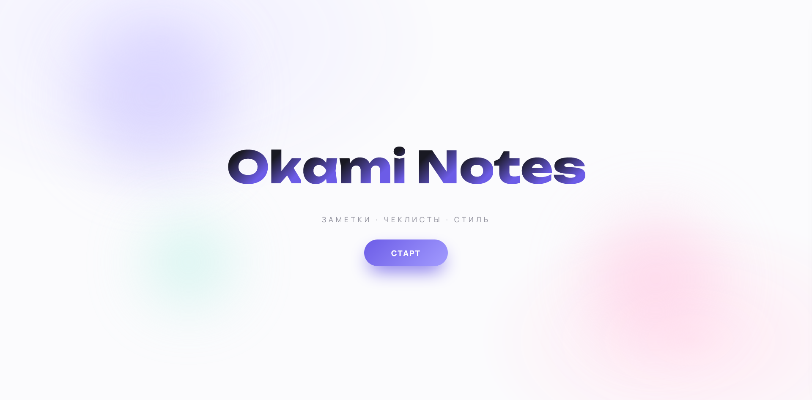
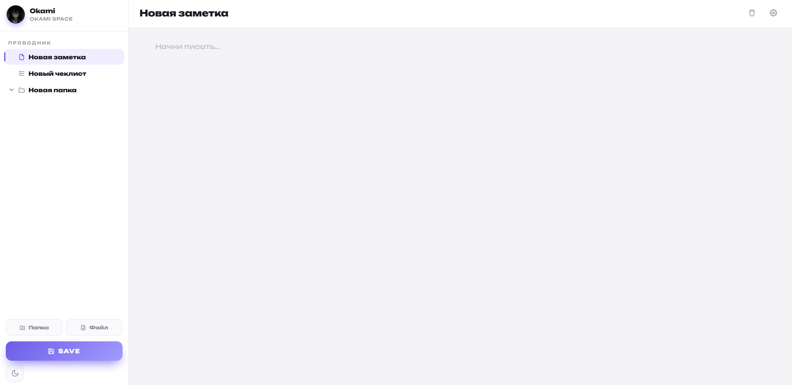

# 🌸 Okami Notes

<p align="center">
  
</p>
<p align="center">
  
</p>

A breathtakingly beautiful, minimalist workspace designed for seamless note-taking, checklist management, and extreme aesthetic customization. Built entirely with vanilla web technologies, **Okami Notes** puts the power of interface design directly into your hands.

---

## ✨ Key Features

### 📁 Smart Workspace & File Tree
* **Dynamic Sidebar:** Easily create, rename, and manage folders and files.
* **Drag-and-Drop Nesting:** Move notes into custom folders intuitively (can be toggled on/off).
* **Multi-Format Files:** Support for free-text **Notes** (for your thoughts and ideas) and progress-tracked **Checklists** (with dynamic completion percentage bars).

### 🎨 Next-Level Customization
* **Real-Time CSS Editor:** Modify any UI component (App background, Sidebar, Editor area, File tree, Buttons, Modals) instantly by injecting custom CSS variables and styles.
* **Themes & Typography:** Switch between Dark and Light themes with beautiful ripple effects. Choose from gorgeous built-ins (*Manrope, Unbounded, JetBrains Mono*).
* **Custom Backgrounds & UI Radiancy:** Upload your own background images with auto-adjusting transparency layers, and fine-tune card corner roundness via ranges.

### 👤 Local Multi-User Profiles
* **Account Switching:** Create multiple independent local profiles. Each profile stores its own unique workspace tree, customization configurations, avatar, and active states inside isolated database environments.
* **Zero Backend Dependency:** Everything runs entirely inside your browser via optimized `localStorage` hooks. Save manually using the hotkey (`Ctrl + S` / `Cmd + S`) or rely on local window state synchronization.

<p align="center">
  
</p>

---

## 🛠️ Tech Stack

* **Frontend:** Vanilla JavaScript (ES6+), HTML5
* **Styling:** Modern CSS3 (CSS Variables, Flexbox, CSS Grid, Advanced keyframe animations) and Tailwind CSS
* **Storage:** LocalStorage API (Client-side localized JSON persistence)
* **Icons:** Dynamic vector SVGs inline injection

---

## 🚀 Getting Started

Since **Okami Notes** is a lightweight serverless client-side application, you can run it instantly without configuring `Node.js` or installing heavy dependencies.

### 1. Clone the repository
```bash
git clone https://github.com
cd Okami-Notes
```

### 2. Run the application
Simply open the `index.html` file in your favorite web browser.

---

## 📂 Project Structure

```text
├── assets/          # Repository branding images and banners
├── index.html       # Application markup and overlay modals template
├── style.css        # Core styling, responsive layouts, and modern themes
└── script.js        # UI rendering engine, workspace tree state, and core logical handlers
```

---

## 📝 License

This project is licensed under the MIT License - feel free to customize and make it your own!
